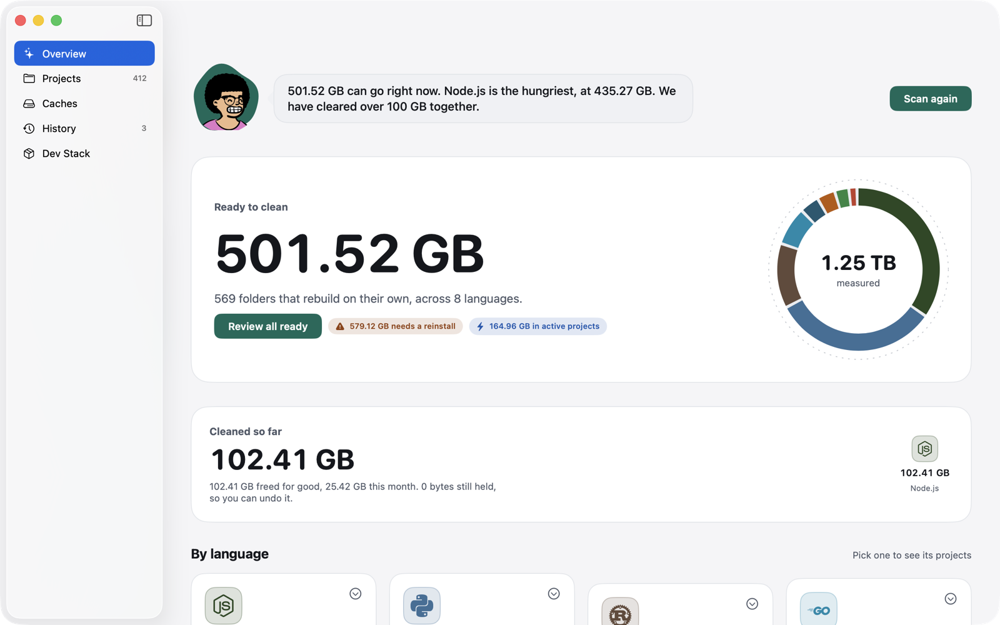
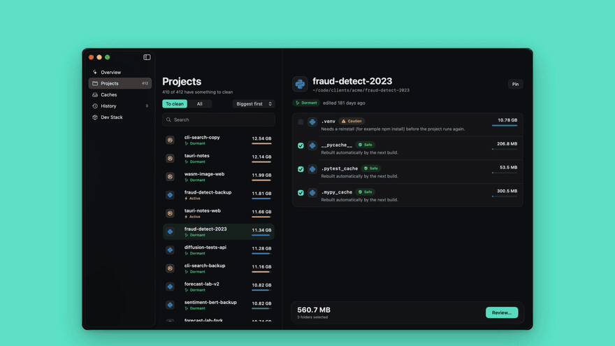
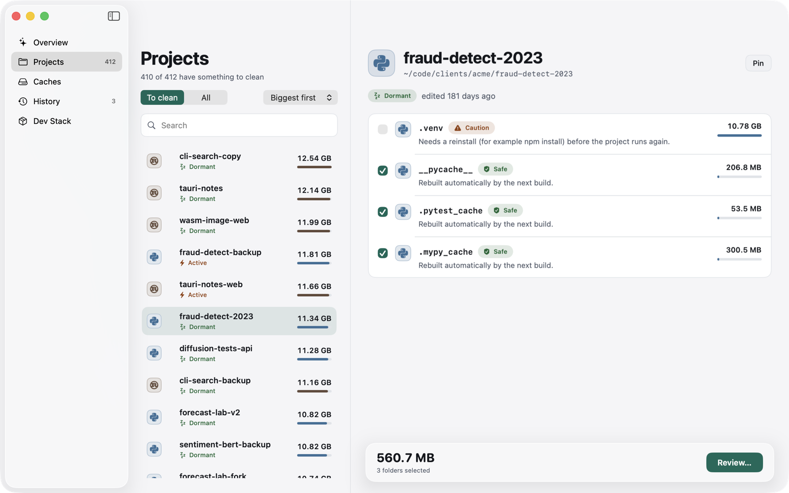
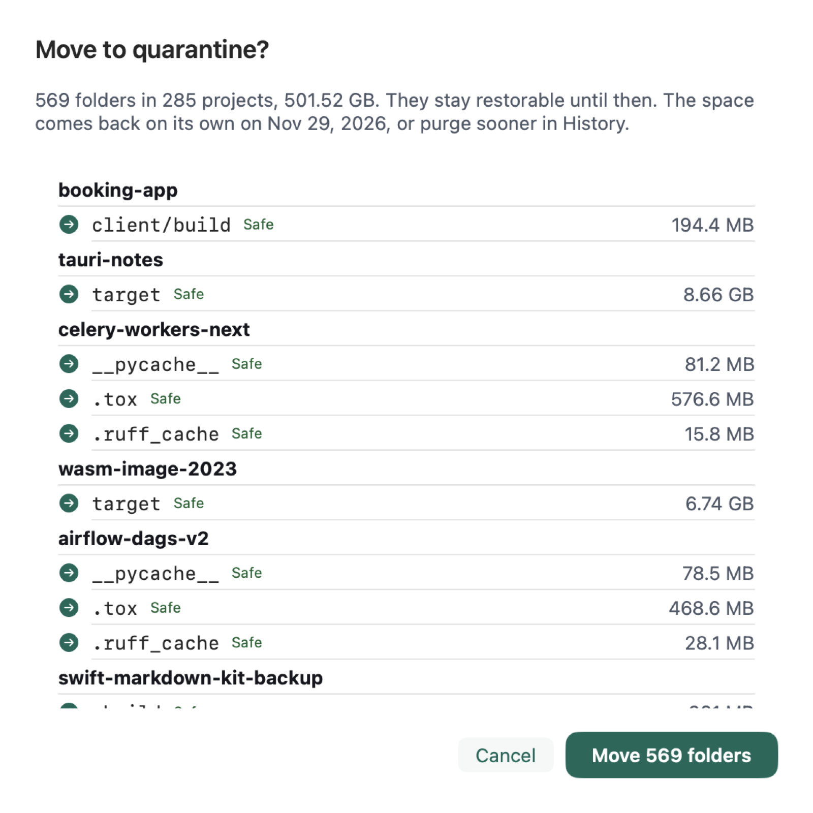
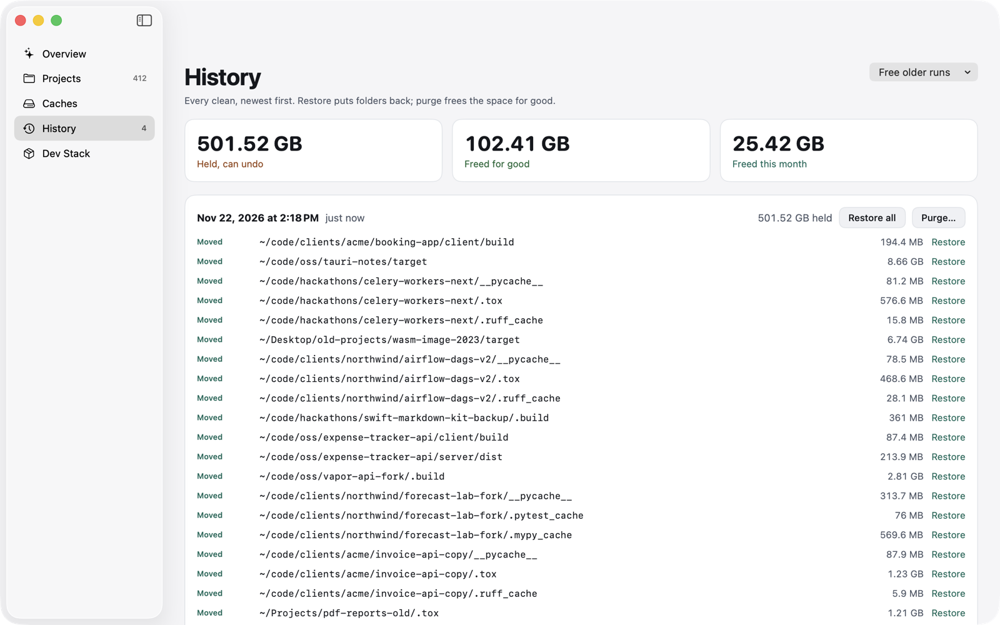
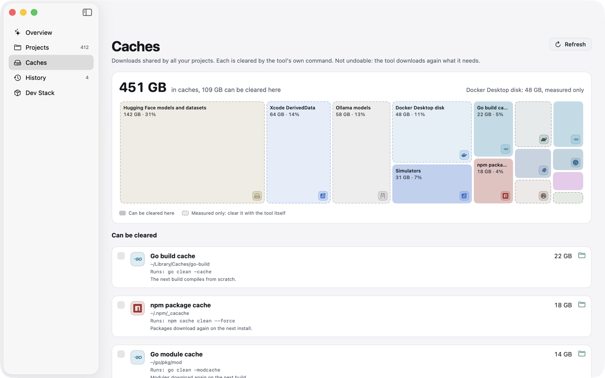
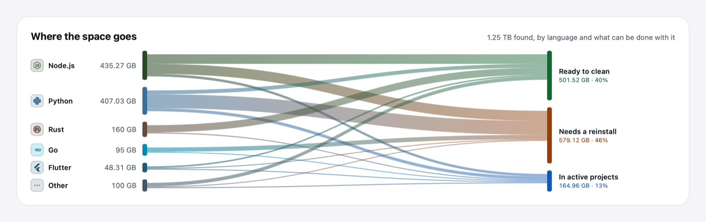
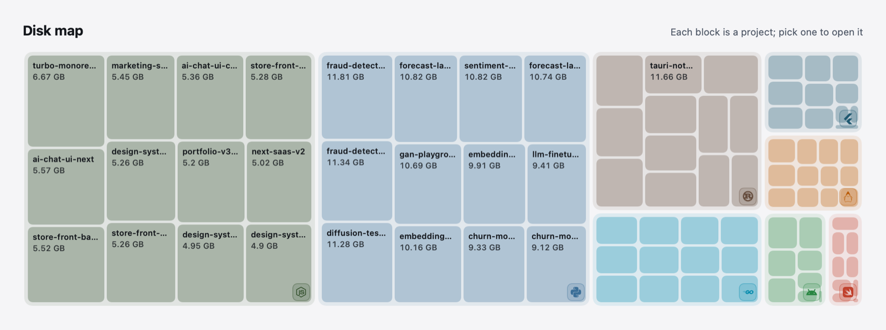
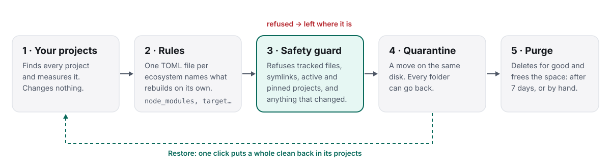

<div align="center">


# OpenSweep

### Get your disk back from `node_modules`, `.venv` and `target`, safely.

**Finds the rebuildable folders in every project on your Mac, tells you why each one is safe to remove, and lets you undo any clean.**

[](https://github.com/Finjineersdev/OpenSweep/releases/latest)
[](https://github.com/Finjineersdev/OpenSweep/actions/workflows/ci.yml)
[](https://github.com/Finjineersdev/OpenSweep/actions/workflows/engine.yml)
[](LICENSE)
[](#install)
[](https://github.com/Finjineersdev/homebrew-tap)

[Install](#install) · [See it work](#see-it-work) · [How it works](#how-it-works) · [What it cleans](#what-it-cleans) · [Safety](#safety) · [Command line](#command-line) · [FAQ](#faq) · [Docs](#documentation)

<code>brew install --cask finjineersdev/tap/opensweep</code>

</div>

> [!IMPORTANT]
> Get OpenSweep from this repository's [Releases](https://github.com/Finjineersdev/OpenSweep/releases)
> or the [finjineersdev/tap](https://github.com/Finjineersdev/homebrew-tap) Homebrew tap.
> Each release carries a SHA-256 checksum, an SBOM and a build attestation you can check
> with `gh attestation verify`; updates are signed for Sparkle.

<div align="center">
<br />

<picture>
  <source media="(prefers-color-scheme: dark)" srcset="docs/assets/screens/overview-dark.png">
  
</picture>

<sub>Screenshots use a demo Mac with made-up projects: 412 projects and 1.25 TB of
build folders on a 2 TB disk (<a href="scripts/demo/engine.py"><code>scripts/demo</code></a>).
The app, its screens and its numbers are real; the data is not.</sub>

<br /><br />
</div>

---

A developer's disk fills up with folders that rebuild on their own: dependencies,
virtual environments, compiler output, framework caches. They hide in hundreds of
old projects, and deleting the wrong one by hand costs an afternoon.

OpenSweep scans every project on your Mac, measures those folders, and sorts each
one: **Safe** (rebuilt by the next build), **Caution** (needs a reinstall first),
or left alone because the project is in use or pinned. One click moves everything
ready into a quarantine you can restore from. Nothing is deleted until you purge,
and nothing leaves your Mac.

## See it work

<div align="center">



</div>

## Install

```bash
brew tap finjineersdev/tap && brew trust finjineersdev/tap   # once: Homebrew asks you to trust a new tap
brew install --cask finjineersdev/tap/opensweep
```

or download the `.dmg` from [Releases](https://github.com/Finjineersdev/OpenSweep/releases)
and drag OpenSweep to Applications. macOS 14 or later. The cask also puts the
`opensweep` command on your PATH.

OpenSweep is open source and not notarized by Apple, so:

- **First launch:** macOS blocks it. Open System Settings > Privacy & Security
  and click **Open Anyway** next to OpenSweep.
- **Full Disk Access:** the first-run guide asks for it once, so a whole-Mac scan
  can read every project folder. Folders macOS still refuses are listed as
  *protected*, never guessed at.
- **After an update:** macOS may forget Full Disk Access. If a scan stops
  seeing folders, turn OpenSweep off and on again under Privacy & Security >
  Full Disk Access.

## A clean in three steps

<table>
<tr>
<td width="50%" valign="top">

**1. Scan.** The whole Mac, or the folders you choose. A scan only reads.
Every project gets a verdict: **Active** (edited or committed in the last 14 days),
**Idle**, **Dormant** (untouched for 90 days), or **Pinned**.

<picture>
  <source media="(prefers-color-scheme: dark)" srcset="docs/assets/screens/projects-dark.png">
  
</picture>

</td>
<td width="50%" valign="top">

**2. Review all ready.** Safe folders in projects nobody is working on are
ticked for you. Caution folders and active projects wait for you to pick them.
The review shows exactly what moves.

<picture>
  <source media="(prefers-color-scheme: dark)" srcset="docs/assets/screens/review-dark.png">
  
</picture>

</td>
</tr>
<tr>
<td width="50%" valign="top">

**3. Undo any time.** Every clean is one entry in History. Restore it whole or
folder by folder. The space comes back when the quarantine is purged: by itself
after 7 days, or sooner by hand.

<picture>
  <source media="(prefers-color-scheme: dark)" srcset="docs/assets/screens/history-dark.png">
  
</picture>

</td>
<td width="50%" valign="top">

**Global caches, too.** npm, pip, uv, Yarn, Go, CocoaPods and simulators are
cleared with each tool's own command. Model stores, Xcode DerivedData, Docker and
editor caches are measured, with what to run yourself.

<picture>
  <source media="(prefers-color-scheme: dark)" srcset="docs/assets/screens/caches-dark.png">
  
</picture>

</td>
</tr>
</table>

<details>
<summary><strong>More screens: where the space goes, the disk map</strong></summary>
<br />

<picture>
  <source media="(prefers-color-scheme: dark)" srcset="docs/assets/screens/space-flow-dark.png">
  
</picture>

<picture>
  <source media="(prefers-color-scheme: dark)" srcset="docs/assets/screens/disk-map-dark.png">
  
</picture>

</details>

Also in the app: a menu bar item with the space ready to clean, an optional
scheduled clean (Safe folders in dormant projects only, with a size cap and an
Undo in its notification), pins that expire or follow a git remote, other local
drives, and a light and a dark appearance.

## How it works

<div align="center">

</div>

The Mac app is a SwiftUI front end. It never touches your files: every scan,
move, restore and purge runs through the bundled Rust engine, the same
`opensweep` binary you can run yourself ([ADR 0002](docs/adr/0002-single-deletion-path.md),
[ADR 0005](docs/adr/0005-engine-as-subprocess.md)).

## What it cleans

Rules are data: one linted, tested TOML file per ecosystem in
[`engine/rules`](engine/rules). **Safe** folders rebuild on the next build;
**Caution** folders need a reinstall (for example `npm install`) before the
project runs again, so they are never ticked for you.

| Ecosystem | Safe | Caution |
| --- | --- | --- |
| Node.js | `.next` `.nuxt` `.svelte-kit` `.turbo` `.parcel-cache` `.angular/cache` `dist` `build` | `node_modules` |
| Python | `__pycache__` `.pytest_cache` `.mypy_cache` `.ruff_cache` `.tox` | `.venv` `venv` |
| Go | | `vendor` |
| Rust | `target` | |
| Java and Kotlin | `target` `build` | `.gradle` |
| Flutter and Dart | `build` `.dart_tool` | `ios/Pods` |
| Android | `app/build` `app/.cxx` | |
| Swift Package Manager | `.build` | |
| Xcode (CocoaPods) | | `Pods` |
| .NET | `bin` `obj` | |
| PHP (Composer) | | `vendor` |

Add your own rules in `~/Library/Application Support/OpenSweep/rules`, or keep a
`.opensweep.toml` in a repository to pin it or exclude folders
([rule schema](docs/RULE-SCHEMA.md)).

## Safety

1. **One deletion path.** Only the Rust engine moves or deletes, and only a path
   a rule matched and the safety guard approved ([safety spec](docs/SAFETY-SPEC.md)).
2. **Refuse when unsure.** Folders with tracked files, symlinks, unreadable
   repositories, installed software, and anything that changed since it was
   checked are refusals. Scanned repositories are treated as hostile input.
3. **Reversible by default.** Cleaning is a move into a quarantine on the same
   drive. Every changing command is a dry run unless you pass `--execute`.
4. **Local only.** No account and no telemetry. The only network call is the
   update check, and the app asks before it makes one.

Every safety rule ships with a test that fails without it; the invariants and
their tests are listed in [docs/SAFETY-SPEC.md](docs/SAFETY-SPEC.md).

## Command line

The engine runs on macOS and Linux. With the cask installed, `opensweep` is on
your PATH. On Linux, or on a Mac without the app, build it with Rust 1.80 or
later:

```bash
cargo install --locked --git https://github.com/Finjineersdev/OpenSweep opensweep-cli
```

From a clone, `cd engine && cargo build`.

```bash
opensweep scan                                   # every project in your home folder, read-only
opensweep scan --whole-disk                      # every folder on the Mac's own disk
opensweep plan  ~/code/my-site                   # one project: what would be allowed
opensweep clean ~/code/my-site                   # dry run: lists what would move
opensweep clean --execute ~/code/my-site         # move Safe folders into quarantine
opensweep clean --execute --include-caution ~/code/my-site   # node_modules, .venv too
opensweep pin ~/code/client-app                  # never clean this folder
opensweep history                                # runs, newest first
opensweep restore <run-id>                       # put everything back
opensweep purge <run-id> --execute               # delete from quarantine, free the space
opensweep caches                                 # global tool caches, measured
```

Cleaning moves folders into `~/Library/Application Support/OpenSweep/Quarantine`
on macOS (`~/.local/share/opensweep/quarantine` on Linux). Because it is a move
on the same disk, **space is freed only when you purge**. Projects on another
drive go to a hidden `.opensweep-quarantine` folder at the top of that drive;
projects on network drives are skipped. Add `--json` to any command for
machine-readable output ([docs/CLI-JSON.md](docs/CLI-JSON.md)).

## FAQ

<details>
<summary><strong>Will it break my projects?</strong></summary>

Safe folders are ones the project's own tools recreate on the next build or run.
Caution folders (`node_modules`, `.venv`, `vendor`, `Pods`) need a reinstall
first, so OpenSweep never ticks them for you. Projects edited or committed in the
last 14 days are left alone unless you ask, and pinned projects are never
cleaned. If you change your mind, restore the run from History.

</details>

<details>
<summary><strong>I cleaned 500 GB. Why is my disk not emptier yet?</strong></summary>

Cleaning is a move into the quarantine on the same disk, so it can be undone.
The space returns when the run is purged: automatically after 7 days (Settings
can change that), or right away with Purge in History.

</details>

<details>
<summary><strong>Does anything leave my Mac?</strong></summary>

No. There is no account, no telemetry and no network code in the engine. The app
checks for updates with Sparkle, asks before the first check, and lets you turn
it off.

</details>

<details>
<summary><strong>Why does macOS block the first launch?</strong></summary>

Releases are ad-hoc signed, not notarized by Apple. Open System Settings > Privacy &
Security and click **Open Anyway** once. You can check a download with the
`.sha256` file and `gh attestation verify` on the release.

</details>

<details>
<summary><strong>What does "protected" mean in the skipped folders?</strong></summary>

macOS privacy protection refused the folder. Give OpenSweep Full Disk Access
and scan again.

</details>

<details>
<summary><strong>How were the screenshots made?</strong></summary>

The Debug app runs a scripted demo against a stand-in engine with made-up data
(`scripts/demo/engine.py`, `scripts/demo/record.sh`); nothing on disk is read
or moved.

</details>

## Documentation

- [docs/HANDOFF.md](docs/HANDOFF.md): history, decisions, current state, what is next.
- [docs/SAFETY-SPEC.md](docs/SAFETY-SPEC.md): every safety invariant and the test that holds it.
- [docs/RULE-SCHEMA.md](docs/RULE-SCHEMA.md): writing rules and `.opensweep.toml`.
- [docs/CLI-JSON.md](docs/CLI-JSON.md): the engine's JSON output.
- [docs/REQUIREMENTS.md](docs/REQUIREMENTS.md): scope, milestones and non-goals.
- [docs/RELEASING.md](docs/RELEASING.md): how a release is built, signed and published.
- [docs/adr](docs/adr): architecture decisions.

Contributors and coding agents: start with [CLAUDE.md](CLAUDE.md) and
[CONTRIBUTING.md](CONTRIBUTING.md). Security reports: [SECURITY.md](SECURITY.md).

## Licence

OpenSweep is open source under the MIT License ([LICENSE](LICENSE)). It
includes third-party code under the MIT and BSD-3-Clause licences; their notices
are in [NOTICE](NOTICE) and [THIRD-PARTY-LICENSES.md](THIRD-PARTY-LICENSES.md).
